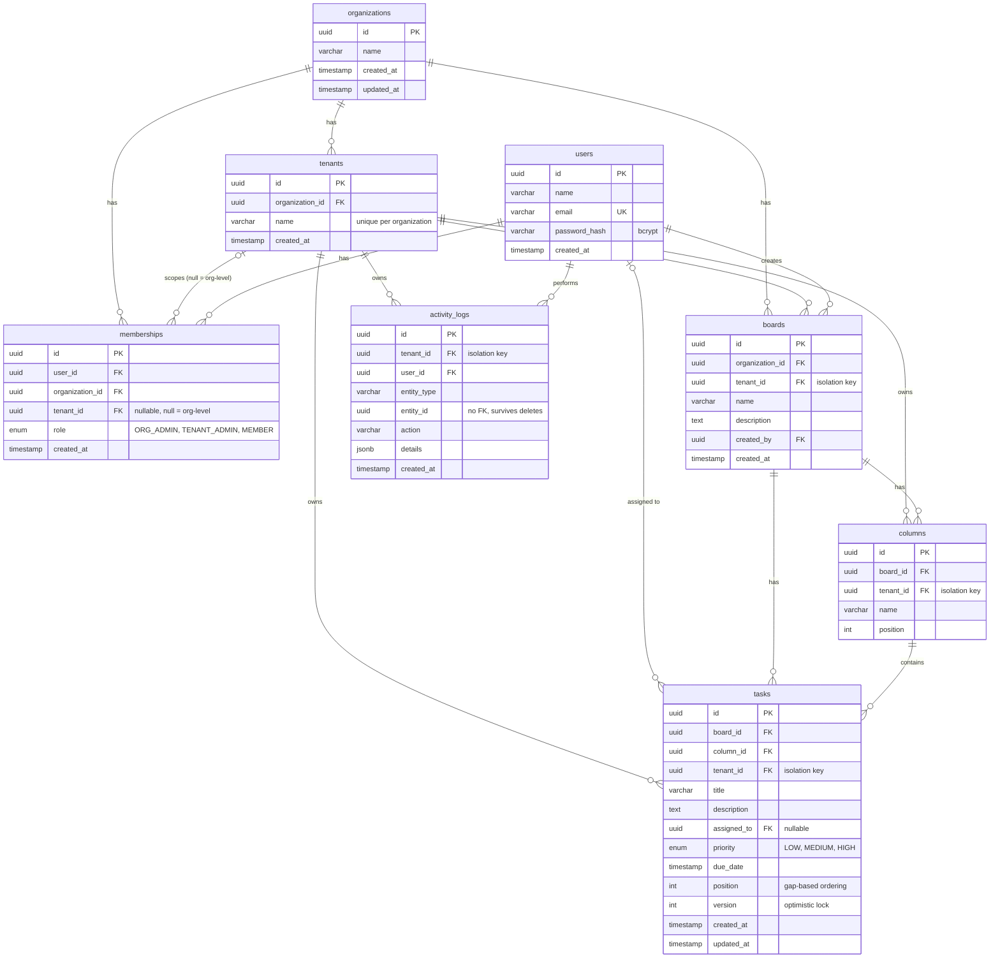

# Database design

PostgreSQL, managed with Prisma (`backend/prisma/schema.prisma` and `backend/prisma/migrations/`). The image export is in `docs/database-erd.png`, and the editable source is `docs/database.dbml`.

## How the schema supports tenant isolation

1. `boards`, `columns`, `tasks` and `activity_logs` each carry a NOT NULL `tenant_id`, indexed. Every query in the backend filters by the tenant that was verified from the user's membership, never by a tenant id the client sends.
2. Composite indexes serve the common tenant-scoped reads: `tasks (tenant_id, board_id)`, `tasks (column_id, position)`, `activity_logs (tenant_id, created_at)`.
3. `memberships.tenant_id` is nullable. NULL means an organization-level role (Org Admin, reaching every tenant of that organization). A set value means a role inside one tenant.
4. Foreign keys cascade from organization and tenant, so removing a tenant removes its boards, columns, tasks and logs.
5. `tasks.version` implements optimistic locking, and `tasks.position` uses gaps (1000, 2000, ...) so a move usually updates one row.
6. `activity_logs.entity_id` has no foreign key on purpose, so the history of a deleted task is kept.

## Known limitations

1. PostgreSQL treats NULLs as distinct in a unique constraint, so the `(user_id, organization_id, tenant_id)` constraint does not stop duplicate org-level memberships (tenant_id NULL). A partial unique index would close this.
2. `tenant_id` on `columns` and `tasks` duplicates the board's tenant for fast filtering. The service layer keeps them equal. The database itself does not enforce that, and PostgreSQL Row-Level Security would be the extra layer.